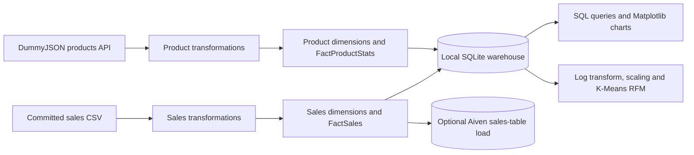

# Unified E-commerce Analytics

A Data Warehousing & Business Intelligence course project exploring sales ETL, dimensional modelling, Power BI reporting, and RFM customer segmentation with Python.

**Python · Pandas · SQLite · SQLAlchemy · PostgreSQL · Power BI · Scikit-learn**

[Project files](#project-files) · [Architecture](#architecture-and-notebook-paths) · [Run locally](#run-the-local-notebook) · [Checked findings](#checked-source-data-findings) · [Course and team](#course-and-team)

> **Current status:** The repository contains the project notebooks, source CSV, Power BI file, presentation, and report. The primary notebook's customer join multiplies sales rows, so its warehouse totals, dashboard figures, and customer segments need revalidation. The figures below describe the committed source CSV; they are not a corrected warehouse run.

## Project files

| File | What it contains |
| --- | --- |
| [Sales dataset](Data/ecommerce_sales_34500.csv) | 34,500 records dated September 12, 2023–September 11, 2025. |
| [DWHBI.ipynb](Notebook/DWHBI.ipynb) | CSV sales mart, a separate DummyJSON product mart, local SQLite loading, SQL/chart analysis, and three-cluster RFM analysis. Includes optional cloud/migration cells. |
| [DWHBI_kaggle.ipynb](Notebook/DWHBI_kaggle.ipynb) | Alternative Northwind/PostgreSQL, Kaggle-path CSV, and API integration experiment; requires external database tables. |
| [Power BI dashboard](PowerBI/Unified%20E-commerce%20dashboard.pbix) | Historical dashboard file; open in Power BI Desktop. Its metrics need reconciliation with the source data. |
| [Presentation](Unified-E-commerce-Analytics.pptx) | Original course presentation; findings are historical and subject to the validation notes below. |
| [Project report](Project_Report.pdf) | Original project write-up, diagrams, and dashboard captures; not a newly validated results report. |

## Architecture and notebook paths

The primary notebook builds **two separate marts**. It does not reconcile the DummyJSON product IDs with sales product IDs into one validated catalogue.



The primary notebook's local tables are:

| Mart | Fact table | Dimension tables |
| --- | --- | --- |
| Sales | `FactSales`: order ID, date/customer/product keys, amounts, quantity, discount, payment method, region, and return flag | `DimCustomer`, `DimProduct_Sales`, `DimDate` |
| API products | `FactProductStats`: product/category keys, price, discount percentage, rating, and stock | `DimProduct_API`, `DimCategory_API` |

The optional Aiven load uses lowercase names such as `dim_customers`, `dim_dates`, and `fact_sales`. The Kaggle notebook uses another schema, including `dim_products` and `dim_regions`; do not treat these paths as interchangeable.

## Run the local notebook

The local workflow can be inspected without a cloud account. It still reproduces the existing join issue; see [validation status](#validation-status-and-limitations) before interpreting its results.

1. Clone the repository and create a Python environment:

   ```bash
   git clone https://github.com/KhuzaimaHassan/Data-Warehousing-and-Business-Intelligence.git
   cd Data-Warehousing-and-Business-Intelligence
   python -m venv .venv
   ```

2. Activate the environment, then install the notebook dependencies:

   ```bash
   # Windows PowerShell
   .\.venv\Scripts\Activate.ps1
   # macOS / Linux: source .venv/bin/activate

   python -m pip install jupyterlab pandas numpy matplotlib scikit-learn requests SQLAlchemy
   python -m jupyterlab
   ```

3. Open `Notebook/DWHBI.ipynb`. The committed extraction cell expects the CSV in the kernel's working directory. Change its `csv_file_name` assignment to `../Data/ecommerce_sales_34500.csv` when the kernel runs in `Notebook/`, or `Data/ecommerce_sales_34500.csv` when it runs from the repository root.

4. For the **local SQLite path**, run the imports, CSV/API extraction, sales transformations, and fact-table cells. Skip the **Load in Aiven Db** section and its connection/load cells. Continue with the API product-mart transformations, SQLite load, validation, SQL/chart analysis, RFM analysis, and connection cleanup. The CSV-export cell also writes `fact_sales.csv` locally.

5. The local load creates `project_data_warehouse.db` in the kernel's working directory. Its row-count check should currently show **179,716 FactSales rows**, not 34,500; this is a known error to investigate, not an acceptance target. Re-running the load replaces the local tables.

The API product mart needs network access to `https://dummyjson.com/products?limit=100`; its response can change. If retrieval fails, the notebook skips that mart. The optional SQLite backup and SQL Server migration cells are outside this local analysis path.

**Cloud and migration paths:** The notebooks contain original project connection settings. Replace them with your own configuration before running any connection/load cells; do not reuse committed credentials. Aiven/PostgreSQL needs SQLAlchemy and a compatible PostgreSQL driver such as `psycopg2-binary`. SQL Server migration additionally needs `pyodbc`, its system ODBC driver, and a configured SQL Server. These loads use table replacement and should only target a database intended for this project. The Kaggle notebook also expects `customers`, `orders`, `products`, and `order_details` tables, whose source database is not included.

There is no pinned dependency file, database snapshot, automated setup script, or live dashboard deployment in this repository. The Power BI file is a separate desktop artifact; opening it does not establish that its original data connections will refresh.

## Checked source-data findings

Recalculated on **November 4, 2026**, from the CSV committed at `a449a75`. These are descriptive calculations on all 34,500 source rows, with no Power BI filters or warehouse joins applied.

| Measure | Source CSV result | Interpretation |
| --- | --- | --- |
| Sum of `total_amount` | **5,865,293.05** | Sum of recorded amounts; no currency, return adjustment, or net-profit definition is inferred. |
| Electronics share of that sum | **56.59%** | Approximately 56.6% of source revenue, rather than an unsupported “over 57%.” |
| Largest aggregated calendar months | **December, April, October** | Month numbers pooled across the dataset's date range; this does not establish recurring seasonality. |
| Two most common payment methods | **Credit Card: 12,170; Debit Card: 8,505** | Counts of source records. COD is third at 4,160. |
| Discount vs. `profit_margin` | **Pearson r = −0.04747** | Weak negative row-level association; no causal effect is established. |
| Records by age band | **18–35: 11,976; 36–55: 13,287; 56+: 9,237** | Record counts, not purchases per customer or a validated demographic segmentation. |

A minimal check, run in a notebook or Python session from the repository root:

```python
import pandas as pd

data = pd.read_csv("Data/ecommerce_sales_34500.csv")
customer_dimension = data[
    ["customer_id", "customer_age", "customer_gender"]
].drop_duplicates()

print("Source rows:", len(data))                         # 34500
print("Recorded amount sum:", round(data.total_amount.sum(), 2))
print("Rows after customer join:", len(
    data.merge(customer_dimension, on="customer_id")
))                                                       # 179716
print("Payment counts:\n", data.payment_method.value_counts())
print("Discount / margin correlation:", data.discount.corr(data.profit_margin))
print("Electronics share (%):", round(
    100 * data.loc[data.category == "Electronics", "total_amount"].sum()
    / data.total_amount.sum(), 2
))
months = pd.to_datetime(data.order_date).dt.month
print("Largest calendar months (1=Jan, 12=Dec):", data.groupby(months)
      .total_amount.sum().nlargest(3))
print("Age-band record counts:", {
    "18-35": int(data.customer_age.between(18, 35).sum()),
    "36-55": int(data.customer_age.between(36, 55).sum()),
    "56+": int((data.customer_age >= 56).sum()),
})
```

## Validation status and limitations

**Customer grain is unresolved.** The CSV has 7,903 customer IDs, but deduplicating `(customer_id, customer_age, customer_gender)` creates 33,877 dimension rows. Of the customer IDs, 7,423 have multiple demographic combinations. Joining that dimension to sales on `customer_id` alone expands 34,500 records into **179,716**, matching the primary notebook's saved output.

That join also increases the sum of `total_amount` from **5,865,293.05** to **30,744,139.07**. The approximately 30.74M warehouse/dashboard figure must therefore not be presented as a validated equivalent of the source revenue.

The notebook's RFM calculation groups by the generated `CustomerKey`, computes recency relative to the latest purchase plus one day, counts distinct order IDs, sums amounts, applies `log1p` and `StandardScaler`, and fits K-Means with three clusters. Its existing segment labels and centroids are **historical outputs**, not validated customer groups; customer identity and amounts must be corrected before interpreting them as “Loyal” or “VIP” segments.

The existing validation cell prints table row counts. It does not enforce unique customer keys at the intended business grain, validate many-to-one join cardinality, or establish database foreign-key constraints. The alternative Kaggle workflow also joins unrelated source IDs and uses different discount calculations in different cells; its integration and metrics require independent checks.

A corrected results release would need an explicit customer/source-key policy, joins validated against that policy, reconciled row counts and amounts, then refreshed clustering, Power BI visuals, slides, and report. The current artifacts remain available for understanding the original course implementation.

## Course and team

- **Course:** CT-472 Data Warehousing & Business Intelligence
- **Institution:** NED University of Engineering & Technology
- **Department:** Computer Science & IT
- **Program:** FYDS (Specialization in Data Science)

| Team member | Student ID |
| --- | --- |
| Ebaad Khan | DT-22045 |
| Ezaan Khan | DT-22046 |
| Syed Ahmed Ali | DT-22301 |
| Muhammad Khuzaima Hassan | DT-22302 |
